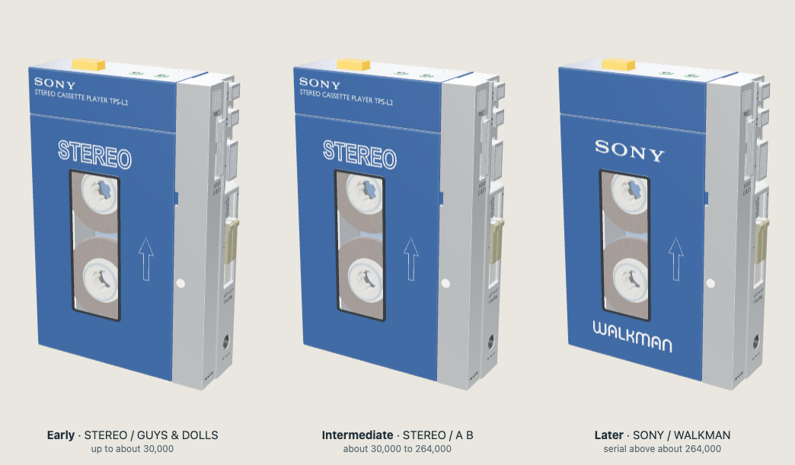

# Portable Tape Player

A 3D model of the Sony TPS-L2 that you can operate, take apart on screen, edit and improve.

This model is an estimate. It was worked out from photographs, videos, Sony’s service manual and the Compact Cassette standard, and no part has yet been checked against a real unit. Every part carries a confirmation level, from 1 (modelled, not checked) to 6 (measured on two units by two people); today all are at level 1.

Serial number 12345 was chosen completely arbitrarily for this model and is not taken from any real unit.

Unofficial project, not affiliated with or endorsed by Sony.

## What is here

| Folder | For | Start with |
|---|---|---|
| `view/` | Looking at the model | Double-click `view/index.html`. Nothing to install. |
| `edit/` | Changing the model, its targets and its parts lists | `edit/EDITING.md`. Needs Blender 5.2 or newer. |
| `rebuild/` | Turning an edit into a new `view/` | `rebuild/REBUILDING.md`. Needs Blender and Node 24. |
| `publish/` | Releasing your own version | `publish/PUBLISHING.md`. |

Keep `view/index.html` and `view/geometry/` side by side. The v0.2.8 automated Chrome checks passed from disk and a web server, including rendered geometry, transport, interrupted STOP/EJECT, keyboard zoom and recovery from failed geometry loads. The new loading/recovery cases also passed in Playwright WebKit. A successful Safari opening smoke was reported by the project owner; the remaining native-browser interaction checks and Firefox verification are incomplete. Automated WebKit is not a substitute for native Safari testing.

In the viewer: press PLAY, drag the volume grips, open the battery cover. **Exterior version** switches between the three versions of the lettering. **Inspect** lets you search by part name, model part ID, or the service manual's Ref. No. and Part No. (try `8-835-008-11`), and lists every part with its confirmation level.

Choose **System**, **Light** or **Dark** for the interface and model backdrop. System follows your device's appearance setting, including changes while the viewer is open. Light and Dark are remembered when browser storage is available; if storage is blocked, the choice still works for the current page. **Reset** keeps your appearance choice. Changing appearance preserves the model's materials and lighting, your camera and selection, and the transport and audio controls.

Projection, component labels and illustrative motion cues are remembered when browser storage is available. Reset, tours and close-ups preserve those choices. Search results can be expanded with **Show more**. Component dimensions use measured solid extents at the assembled/rest pose; the precision disclosure and **Copy part details** identify the selected variant and basis. Use **Collapse details** to keep the component name visible on a narrow screen, and Escape or Close to dismiss the inspector.

If graphics cannot start, the parts catalog remains available, with one manual **Reload viewer** action. When model metadata is missing too, the embedded master list and its CSV remain available.

## How sure is it

| Level | Meaning |
|---|---|
| 0 | Not modelled |
| 1 | Modelled estimate; its basis has not been independently assessed |
| 2 | Based on reference material: standards, manufacturer specifications, photos or service manuals |
| 3 | Estimated from photographs using a defined measuring reference or system |
| 4 | Measured from a physical part, without additional supporting evidence |
| 5 | Measured from a physical part with supporting evidence |
| 6 | Level 5 corroborated by at least two people using two different physical units |

A part's level is the lowest level among the features that define it.

- `view/master-parts.csv` lists every part, and every service-manual part not modelled yet, with its level and its size in the model. Those sizes are the model's own, not measurements.
- `view/TARGETS.md` lists the numbers the model is meant to match and how it compares today.

Known problems:

- **Body:** the front is about 88 mm wide in the model; the target is 85 mm. Depth, window shape and margins are uncertain.
- **Cassette bay:** a standard cassette does not yet seat with proper clearance.
- **Cassette-bay rail and lid:** the new blue headphone-end rail (BAY-073) intersects the folded end rim of the cassette lid (EXT-030) when the lid is closed or partly open. The closed-lid overlap runs across the rail's 63.6 mm width and involves a 0.55 mm thick section of the lid rim.
- **Cassette-bay rail and EJECT lever:** the folded EJECT lever (STP-003) also intersects BAY-073 near full eject with the lid open. At full stroke the measured maximum vertex penetration into the rail is approximately 0.059 mm. Both rail collisions remain known geometry errors; their dimensions are unchanged pending better reference evidence for a correction.
- **Drive:** the flywheel's depth remains about 1 mm away from the photographed target; its belt-groove width now meets the target. Belts and springs are shown only.
- **Solids:** many parts are not single closed solids; the master list says which and why.
- **Early exterior:** its white STEREO and dark key legends are printed over the moulded letters of the shared shells; a real early player is flat there. The older lettering is placed by eye from one photograph.
- **Separated views** are illustrations, not removal instructions.

## Take part

Three ways, each fine by itself.

1. **Enjoy it and share it.** It is free to use and share with credit (see Licences).
2. **Send a measurement.** Pick the part in the viewer's Inspect panel and choose "Confirm a feature". Say which exterior version your player is, what you measured and where the measurement starts and ends, the value and the instrument. For photo-only evidence, choose "Report a correction" instead. The maintainer reviews the evidence before adjusting the model.
3. **Adjust a part yourself.** Edit your own copy in Blender, put it anywhere you like, and send a link to it with the measurement it rests on.

A submission is public: hide serial numbers, leave out your name and address, and remove location data from photographs. Every submission is reviewed, and a part's level rises only when the model matches.

## Licences

MIT, for the model and the code. Details and third-party notices are in `LICENSES.md`.
