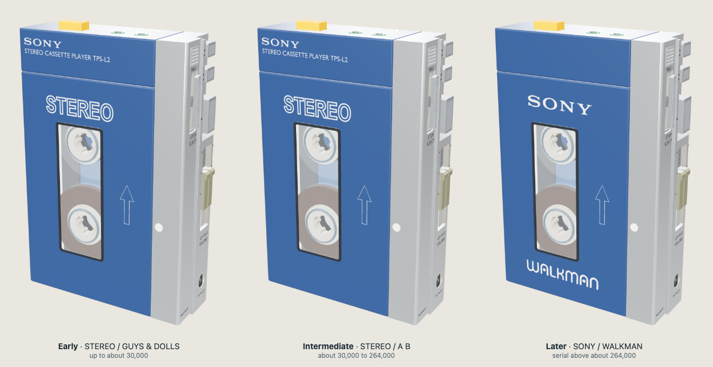

# Portable Tape Player

A 3D model of the Sony TPS-L2 that you can operate, take apart on screen, edit and improve.

This model is an estimate. It was worked out from photographs, videos, Sony’s service manual and the Compact Cassette standard, and no part has yet been checked against a real unit. Every part carries a confirmation level, from 1 (modelled, not checked) to 6 (measured on two units by two people); today all are at level 1.

Serial number 12345 was chosen completely arbitrarily for this model and is not taken from any real unit.

Unofficial project, not affiliated with or endorsed by Sony.

## What is here

| Folder | For | Start with |
|---|---|---|
| `view/` | Looking at the model | Double-click `view/index.html`. Nothing to install. |
| `edit/` | Changing the model, its targets and its parts lists | `edit/EDITING.md`. Needs Blender 5.2 or newer. |
| `rebuild/` | Turning an edit into a new `view/` | `rebuild/REBUILDING.md`. Needs Blender and Node 24. |
| `publish/` | Releasing your own version | `publish/PUBLISHING.md`. |

Keep `view/index.html` and `view/geometry/` side by side. Chrome and Safari are supported; Firefox is untested. The v0.3.1 automated Chrome checks passed from disk and a web server, including rendered geometry, transport, interrupted STOP/EJECT, keyboard zoom, recovery from failed geometry loads and the music. Safari is checked by hand.

In the viewer: press PLAY, drag the volume grips, open the battery cover. The tape winds from reel to reel at the real speed, 4.76 cm/s at 1×. Under **Sound**, choose **Enable sound** to hear it: Canon in D, recorded from the start of side A, plays at the motion speed: the viewer opens at 1×, real speed, and a slower motion speed plays it slow and low, as a real tape would; after the song the tape runs on silently to the end of the side, about 19 minutes at 1×. **Generated test tone** fills the side instead. **Exterior version** switches between the three versions of the lettering. **Inspect** lets you search by part name, model part ID, or the service manual's Ref. No. and Part No. (try `8-835-008-11`), and lists every part with its confirmation level.

**Accessories** shows the MDR-3L2 headphones to the player's left, the AC-31 adapter to its right and two AA cells in the battery case, whose springs then press on them. They are hidden at first, counted apart from the player's parts and not held to its targets. Their shapes are estimated from photographs; the driver and pad sizes, blade spacing and adapter ratings in `view/TARGETS.md` carry their sources.

With the accessories shown, two choices plug them in: the headphones into socket A or B, the adapter into DC IN. The accessory moves to a place beside the player and its plug slides in; the socket springs give way to it, and the adapter's plug opens the battery's switch contact. The separated views show the accessories unplugged. The plugs, their places and the cords' routes are designed to fit the model, not measured.

Choose **System**, **Light** or **Dark** for the interface and model backdrop. System follows your device's appearance setting, including changes while the viewer is open. Light and Dark are remembered when browser storage is available; if storage is blocked, the choice still works for the current page. **Reset** keeps your appearance choice. Changing appearance preserves the model's materials and lighting, your camera and selection, and the transport and audio controls.

Component labels and illustrative motion cues are remembered when browser storage is available; Reset, tours and close-ups preserve them. The viewer always opens in perspective. Search results can be expanded with **Show more**. Component dimensions use measured solid extents at the assembled/rest pose; the precision disclosure and **Copy part details** identify the selected variant and basis. Use **Collapse details** to keep the component name visible on a narrow screen, and Escape or Close to dismiss the inspector.

If graphics cannot start, the parts catalog remains available, with one manual **Reload viewer** action. When model metadata is missing too, the embedded master list and its CSV remain available.

## How sure is it

| Level | Meaning |
|---|---|
| 0 | Not modelled |
| 1 | Modelled estimate; its basis has not been independently assessed |
| 2 | Based on reference material: standards, manufacturer specifications, photos or service manuals |
| 3 | Estimated from photographs using a defined measuring reference or system |
| 4 | Measured from a physical part, without additional supporting evidence |
| 5 | Measured from a physical part with supporting evidence |
| 6 | Level 5 corroborated by at least two people using two different physical units |

A part's level is the lowest level among the features that define it.

- `view/master-parts.csv` lists every part, and every service-manual part not modelled yet, with its level and its size in the model. Those sizes are the model's own, not measurements.
- `view/TARGETS.md` lists the numbers the model is meant to match and how it compares today.

What the model rests on: its shapes and places are estimated from photographs, videos and Sony's service manual, and none was measured on a real unit. The wiring follows Sony's schematic and board drawings; its routes, gauges and lengths are designed. The tests check its connections only within the model: every wire end on its land and every wire touching only its own lands, within 0.002 mm. The accessories' plugs, places and cord routes, and the cells' seats, are designed to fit the model. The approximations known so far are listed below.

Known problems:

- **Body:** the front is about 88 mm wide in the model; the target is 85 mm. Depth, window shape and margins are uncertain.
- **Cassette bay:** narrowing the body to its target width leaves 1.398 mm for the left wall and clearance, below the 2 mm working minimum. The end gaps are 1.65 mm at the top rail and 1.0 mm at the battery-end block; these are designed model gaps.
- **Drive:** the flywheel's depth remains about 1 mm away from the photographed target; its belt-groove width now meets the target. Belts and springs are shown only.
- **Headphone end:** the servo board, lock assembly, motor and control base are laid out differently from the real player here, so the FF and REW levers and the lock plate pass through L601, RV601, Q603, C606 and some wires, the lock spring and counter bracket run into the motor, and the control base meets the POWER switch parts. Photographs suggest a thicker, longer motor and a larger board sitting further toward this end. Rebuilding this end as one group is left to a later release.
- **Board copper:** in places the copper disagrees with the schematic as the model reads it. On the main board, 7 joins and 9 breaks between copper areas, where Sony's board drawing is not legible enough to settle them; on the servo board, the + rail is split at R607/R609 and RV601's free end is joined to its wiper; on the jack board, the return island of R814 and R815 reaches no ground. Some may be errors in the model's reading of the schematic rather than in the copper.
- **Solids:** many parts are not single closed solids; the master list says which and why.
- **Early exterior:** its white STEREO and dark key legends are printed over the moulded letters of the shared shells; a real early player is flat there. The older lettering is placed by eye from one photograph.
- **DC IN socket:** the socket's positive contact and its battery switch sit behind the plug cavity's floor, so nothing in the model touches the adapter plug's barrel. Plugging in opens the switch, but how the plug does that inside the socket is not shown. The plug seats with its barrel end on the cavity floor, 1.41 mm off the case.
- **Accessory cords:** as posed unplugged, the headphones' coil and the adapter's wraps bend tighter than three times the cord's width. The lengths that move when they are plugged in meet that.
- **Separated views** are illustrations, not removal instructions.

## Take part

Three ways, each fine by itself.

1. **Enjoy it and share it.** It is free to use and share with credit (see Licences).
2. **Send a measurement.** Pick the part in the viewer's Inspect panel and choose "Confirm a feature". Say which exterior version your player is, what you measured and where the measurement starts and ends, the value and the instrument. For photo-only evidence, choose "Report a correction" instead. The maintainer reviews the evidence before adjusting the model.
3. **Adjust a part yourself.** Edit your own copy in Blender, put it anywhere you like, and send a link to it with the measurement it rests on.

A submission is public: hide serial numbers, leave out your name and address, and remove location data from photographs. Every submission is reviewed, and a part's level rises only when the model matches.

## Licences

MIT, for the model, the music and the code. Details and third-party notices are in `LICENSES.md`.
